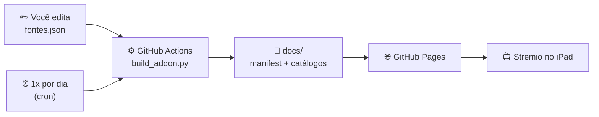

# AdriaFlix 🌊

> Seu streaming favorito, do jeitinho da Ponyo 🌊 — filmes, séries e canais das fontes que você cadastra.

Addon de [Stremio](https://www.stremio.com/) **100% estático**: roda no **GitHub Pages**, é atualizado pelo **GitHub Actions** e não precisa de VPS, servidor nem cartão de crédito.

**Novo na v2:** é só colar a **URL** da fonte no `fontes.json`. O extrator automático descobre sozinho se é uma página de vídeo, uma página de listagem, um feed RSS/YouTube, um sitemap, uma playlist M3U, um JSON ou o Internet Archive.

- **ID do addon:** `org.adriaflix.legal`
- **Você só mexe em um arquivo:** `fontes.json`



---

## Estrutura do repositório

```
adriaflix/
├── fontes.json                  ← ✏️ o ÚNICO arquivo que você edita
├── README.md
├── scripts/
│   ├── build_addon.py           ← gerador estático (só Python padrão, sem pip)
│   ├── extrator.py              ← 🆕 extrator automático de URLs (HTML, RSS, sitemap...)
│   └── gerar_assets.py          ← (opcional) refaz logo e fundo
├── .github/workflows/update.yml ← atualização automática (push + diária)
├── exemplos/                    ← modelos de custom_json, m3u e fontes avançadas
└── docs/                        ← 📦 gerado automaticamente → vira o site
    ├── assets/logo.png
    ├── assets/background.png
    └── (manifest.json, catalog/, meta/, stream/, index.html — criados pelo Actions)
```

---

## Passo a passo

### 1) Crie o repositório

1. Entre em <https://github.com/new>.
2. **Repository name:** por exemplo `adriaflix`.
3. Marque **Public** (o GitHub Pages gratuito exige repositório público).
4. Clique em **Create repository**.

### 2) Suba os arquivos

Na página do repositório vazio, clique em **uploading an existing file** e arraste **todo o conteúdo** desta pasta (`fontes.json`, `README.md`, `scripts/`, `docs/`, `exemplos/`, `.gitignore`).

> ⚠️ **Pasta oculta `.github`:** alguns navegadores não enviam pastas que começam com ponto. Depois do upload, confira se existe `.github/workflows/update.yml`. Se não existir, clique em **Add file → Create new file**, digite exatamente `.github/workflows/update.yml` no nome e cole o conteúdo do arquivo.

Clique em **Commit changes**.

### 3) Libere o Actions para gravar no repositório

**Settings → Actions → General → Workflow permissions** → escolha **Read and write permissions** → **Save**.

### 4) Ative o GitHub Pages apontando para `/docs`

1. **Settings → Pages**.
2. Em **Build and deployment → Source**, escolha **Deploy from a branch**.
3. **Branch:** `main` e a pasta **`/docs`** → **Save**.

Seu site ficará em `https://<usuario>.github.io/<repo>/`.

### 5) Rode a primeira geração

O workflow roda sozinho quando o `fontes.json` é enviado. Para conferir (ou forçar):

1. Aba **Actions → Atualizar AdriaFlix 🌊**.
2. **Run workflow** → **Run workflow**.
3. Aguarde o ✅ verde (costuma levar 1–3 minutos) e mais ~1 minuto para o Pages publicar.

Teste no navegador: `https://<usuario>.github.io/<repo>/manifest.json` deve mostrar um JSON.

### 6) Instale no Stremio do iPad 📱

**Jeito mais fácil:**

1. No **Safari do iPad**, abra `https://<usuario>.github.io/<repo>/`.
2. Toque em **⭐ Instalar no Stremio** e confirme.

**Jeito manual:** no Stremio, abra a área de **Addons** e cole o link
`https://<usuario>.github.io/<repo>/manifest.json` no campo de instalação por URL.

Pronto: as fileiras 🎬 📺 📚 aparecem na tela inicial e em **Descobrir**. 🎉

---

## ⚡ O jeito rápido: só colar a URL

No `fontes.json`, uma fonte pode ser **só o endereço**:

```json
{
  "fontes": [
    "https://site-que-eu-tenho-direito.com/filmes/",
    { "url": "https://exemplo.com/serie/", "tipo": "series", "nome": "Minha Série", "icone": "📺" },
    { "url": "https://exemplo.com/filmes/pagina/{n}/", "paginas": 3, "limite": 60 }
  ]
}
```

Tudo que você não informar é preenchido: `tipo` = `movie`, `provedor` = `auto`, `nome` = domínio do site e `id` gerado a partir da URL. Para séries ou canais, informe `"tipo": "series"` / `"tipo": "tv"`.

### Teste antes de publicar

Antes de colar no `fontes.json`, veja o que o extrator enxerga naquela URL (não gera nada, só mostra):

```bash
python scripts/build_addon.py --testar-url "https://exemplo.com/filmes/" --tipo movie --limite 5
```

### O que o extrator entende

| A URL é… | O que acontece |
|---|---|
| **Link direto** `.mp4` `.m3u8` `.webm` `.mpd` | Vira um título com esse stream. |
| **Página de um vídeo** | Lê `<video>`, `<source>`, `og:video`, JSON-LD (`VideoObject`/`Movie`) e links de mídia escritos no código da página. Pega título, sinopse, pôster, ano, gêneros e duração dos metadados. |
| **Página de listagem** (cards com imagem) | Segue cada card até a página do título e extrai o vídeo de cada um. Menus, rodapés e páginas "sobre/contato" são ignorados. |
| **Feed RSS / Atom** (podcasts de vídeo, canais do YouTube) | Cada item vira um título (ou um episódio, se `tipo: series`). |
| **Playlist/canal do YouTube** (`/playlist?list=…`, `/channel/UC…`) | Usa o feed público do YouTube; os vídeos abrem via `ytId`. |
| **`sitemap.xml`** | Cada `<loc>` é tratado como uma página de título (use `incluir` para filtrar). |
| **Playlist M3U** / **JSON** | Mesmo comportamento dos provedores `m3u` e `custom_json`. O JSON aceita nomes alternativos (`title`, `image`, `video`…). |
| **archive.org** (item, coleção ou busca) | Usa o provedor do Internet Archive automaticamente. |

### Opções do provedor `auto`

| Campo | Padrão | Descrição |
|---|---|---|
| `url` | — | Endereço da fonte. Use `{n}` para paginar (`.../page/{n}/`). |
| `paginas` | 1 | Quantas páginas gerar com `{n}` (máx. 20). |
| `limite` | 30 | Máximo de títulos (teto 300). |
| `limite_episodios` | 40 | Máximo de episódios por série (teto 300). |
| `incluir` / `excluir` | — | Expressões regulares para filtrar os links seguidos. Ex.: `"incluir": "/filme/"`. |
| `seguir_links` | `true` | `false` = trata a URL como uma única página, sem seguir cards. |
| `permitir_externo` | `false` | Se não achar vídeo, cria um stream "Abrir no site" (abre no navegador). |
| `pausa` | 0.6 | Segundos de espera entre requisições ao mesmo site. |
| `respeitar_robots` | `true` | Obedece o `robots.txt`. Só desligue em site que é seu. |
| `user_agent` | AdriaFlix/2.0 | Identificação enviada ao site. |
| `formato_poster` | `poster` | `poster`, `landscape` ou `square`, conforme as imagens da fonte. |
| `ativo` | `true` | `false` desliga a fonte sem apagá-la. |
| `seletores` | — | Ajuste fino por CSS (abaixo). |

### Ajuste fino com `seletores` (quando o automático errar)

Se o site tem um HTML fora do comum, diga onde estão as coisas com seletores CSS simples (`tag`, `.classe`, `#id`, `[atributo]`, espaço e `>`). Use `seletor@atributo` para ler um atributo; sem `@`, lê o texto.

```json
{
  "url": "https://exemplo.com/filmes/",
  "nome": "Minha Biblioteca",
  "seletores": {
    "cartao": {
      "item":   "li.filme",
      "link":   "a.ver@href",
      "titulo": ".t",
      "poster": "img.capa"
    },
    "pagina": {
      "titulo":    ".nome",
      "descricao": ".sinopse",
      "ano":       ".ano",
      "generos":   ".g",
      "poster":    ".capa img",
      "video":     "#player@data-stream",
      "episodios": ".lista-eps a"
    }
  }
}
```

`cartao` descreve cada card da página de listagem; `pagina` descreve a página de cada título. Todos os campos são opcionais.

### Limites do extrator (leia antes de se frustrar)

- **Não executa JavaScript.** Se o vídeo só aparece depois de scripts, de cliques ou de várias telas intermediárias, o título fica sem stream (o teste mostra "nada reproduzível").
- **Não contorna** captcha, login, proteção anti-robô nem redirecionamentos encadeados — e não vai passar a fazer isso.
- **Links mudam.** Como o catálogo é gerado 1×/dia, links que expiram (com token/assinatura) ou sites que mudam de estrutura/domínio quebram. Os títulos que falharem na próxima execução simplesmente somem, e a fileira inteira some se nada for encontrado; veja o log em **Actions**.
- **Referer/cookies:** streams que só tocam com cabeçalhos especiais não tocam no Stremio.
- Prefira URLs **https**; links `http` podem ser bloqueados em alguns players.
- Use **MP4/HLS**: `.webm`, `.ogv`, `.mkv` e `.mpd` costumam não tocar no iPad.

---

## Como editar o `fontes.json` (pelo navegador, sem código)

1. No repositório, clique em `fontes.json` → ícone de **lápis ✏️**.
2. Adicione, altere ou remova entradas.
3. **Commit changes**. O Actions refaz tudo automaticamente em poucos minutos.

Se houver erro de vírgula ou campo faltando, a aba **Actions** mostra uma mensagem clara em português e o addon continua funcionando com a última versão.

### Campos de cada fonte

| Campo | Obrigatório | Descrição |
|---|---|---|
| `id` | ✅ | Identificador único (letras, números, `_` e `-`). |
| `nome` | ✅ | Nome da fileira. |
| `icone` | | Emoji na frente do nome. |
| `tipo` | ✅ | `movie`, `series` ou `tv`. |
| `provedor` | ✅* | `auto` (padrão quando há `url`), `internet_archive`, `custom_json` ou `m3u`. |
| `query` | IA | Busca do Internet Archive. |
| `url` / `arquivo` | JSON/M3U | URL http(s) **ou** caminho de um arquivo dentro do repositório. |
| `limite` | | Máximo de títulos (padrão 30; teto 300). |
| `origem` | | Nome exibido como origem (auto/custom_json/m3u). |

\* Com `url` você pode omitir `id`, `nome`, `tipo` e `provedor` (veja ⚡ acima).

### Provedor `internet_archive`

Usa `archive.org/advancedsearch.php` + `archive.org/metadata/{id}` e monta o link direto `.mp4` (com alternativas leve e `.ogv`/`.webm` quando existem), sem propaganda. Itens de **empréstimo/restritos** são descartados automaticamente.

Opções extras:

- `"exigir_licenca_aberta": true` — só entram itens cujo cadastro no Internet Archive traz licença de domínio público ou Creative Commons.
- `"rotulo_origem": "..."` — texto de origem que **você** afirma para a fonte inteira.
- `"ordenar": "date desc"` — ordenação da busca (padrão: `downloads desc`).

Exemplos de `query`:

```
collection:feature_films AND mediatype:movies
collection:classic_tv AND mediatype:movies
collection:opensource_movies AND subject:documentary
collection:prelinger AND mediatype:movies
collection:animationandcartoons AND mediatype:movies
```

### Provedor `custom_json` (seu catálogo próprio)

Aponte `url` para qualquer JSON seu (ou `arquivo` para um JSON dentro do repositório). Modelo completo em [`exemplos/catalogo_exemplo.json`](exemplos/catalogo_exemplo.json):

```json
{
  "itens": [
    {
      "id": "meu-filme",
      "nome": "Meu Filme",
      "ano": 1925,
      "descricao": "Sinopse.",
      "poster": "https://.../poster.jpg",
      "fanart": "https://.../fanart.jpg",
      "generos": ["Drama"],
      "duracao": "90 min",
      "origem": "Meu acervo",
      "licenca": "https://creativecommons.org/publicdomain/mark/1.0/",
      "streams": [{ "url": "https://.../filme.mp4", "titulo": "Legendado" }]
    }
  ]
}
```

Para `tipo: "series"`, troque `streams` por `episodios`: `[{ "temporada": 1, "episodio": 1, "titulo": "...", "url": "..." }]`.

Um stream também pode ser `{ "yt": "ID_DO_VIDEO" }` (YouTube) ou `{ "externo": "https://..." }` (abre no navegador).

### Provedor `m3u` (playlists legais)

Aponte `url` ou `arquivo` para uma playlist `#EXTM3U`. São lidos `tvg-logo`, `group-title` (vira gênero) e o nome. Modelo em [`exemplos/playlist_exemplo.m3u`](exemplos/playlist_exemplo.m3u). Veja mais combinações em [`exemplos/fontes_avancadas.json`](exemplos/fontes_avancadas.json).

---

## Atualização automática

O workflow [`update.yml`](.github/workflows/update.yml) roda:

- **a cada push** que altere `fontes.json` (ou o gerador);
- **1 vez por dia** (06:17 UTC = 03:17 em Brasília);
- **manualmente** pelo botão *Run workflow*.

Ele executa `python scripts/build_addon.py` e faz commit automático da pasta `docs/` (só se algo mudou).

---

## O que o addon faz — e o que não faz

Como tudo é arquivo estático (sem servidor), alguns recursos do Stremio **não existem** aqui:

- ❌ **Busca por texto:** exigiria um servidor para responder cada pesquisa. No lugar, cada fileira tem **filtro por gênero** (em *Descobrir*), gerado a partir dos assuntos dos títulos.
- ❌ **Paginação infinita:** cada fileira mostra até o `limite` que você configurou.
- ✅ Filmes, séries com temporadas/episódios, canais (`tv`), pôster, fanart, sinopse com origem e links diretos.

---

## Aviso legal ⚖️

O AdriaFlix **não hospeda nenhum vídeo**: ele só organiza links de fontes que **você** cadastra. Como o repositório e o GitHub Pages são públicos, o catálogo que você gerar também fica público.

- **Você é o responsável** por só cadastrar fontes que tenha o direito de usar: domínio público, Creative Commons, conteúdo seu, de quem autorizou, ou transmissões oficiais gratuitas.
- Não cadastre sites que distribuem filmes/séries sem autorização dos detentores dos direitos: isso pode violar direitos autorais e os termos do GitHub, que pode remover o repositório.
- O extrator respeita o `robots.txt` por padrão e espera entre requisições; mantenha assim em sites que não são seus.
- O Internet Archive abriga muito material em domínio público, mas **não garante** que toda a coleção seja livre. A sinopse mostra a licença quando o item a declara; sem licença declarada, aparece *"coleção aberta — confira a licença"*. Use `exigir_licenca_aberta` se quiser ser mais restrito.

---

## Solução de problemas

| Sintoma | O que fazer |
|---|---|
| `manifest.json` dá 404 | Confira **Settings → Pages** (branch `main`, pasta `/docs`) e se o Actions terminou com ✅. |
| Actions falha com *permission denied* | **Settings → Actions → General → Read and write permissions**. |
| Falta a pasta `.github` | Crie o arquivo manualmente (passo 2). |
| Fileira sumiu | A fonte falhou ou não achou vídeos tocáveis; veja o log em **Actions**. Ajuste a `query` ou rode de novo. |
| Atualização diária parou | O GitHub pausa agendamentos de repositórios sem atividade por ~60 dias. Rode **Run workflow** uma vez para reativar. |
| Vídeo não toca | Tente o stream “MP4 Direto (leve)”; arquivos `.ogv`/`.webm` podem não tocar no iPad. Se o link veio de uma página, ele pode ter expirado: rode **Run workflow** de novo. |
| `--testar-url` diz "nada reproduzível" | A página provavelmente monta o vídeo com JavaScript, exige login ou o `robots.txt` bloqueia. Tente `seletores`, `permitir_externo`, ou outra fonte. |
| Todos os títulos de uma listagem viraram "filme" mas eram episódios | Defina `"tipo": "series"` na fonte. |
| Pôsteres cortados/estranhos | Ajuste `"formato_poster": "landscape"` (imagens 16:9). |
| Fez mudanças no addon | No Stremio, remova e reinstale o addon para ele reler o manifest. |

## Testando no seu computador (opcional)

```bash
python scripts/build_addon.py --base-url http://localhost:8000
cd docs && python -m http.server 8000
```

Depois use `http://localhost:8000/manifest.json` no Stremio do computador.
